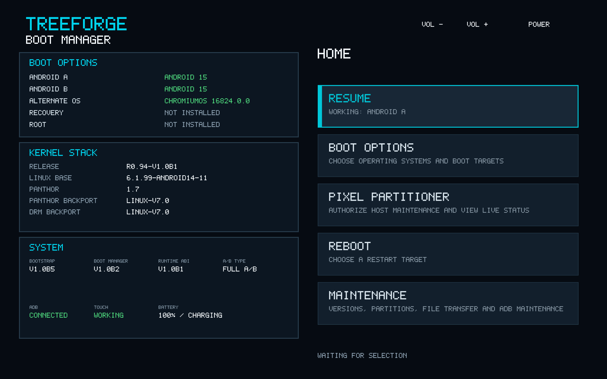

# TreeForge Bootstrap

TreeForge Bootstrap brings a boot menu and early ADB access to the Google Pixel
Tablet. It runs before Android starts, letting you continue into
Android or boot an alternate OS from the tablet's storage.

Bootstrap is the runtime behind **TreeForge Boot Manager**. This repository
contains the early-boot code and the host tools used to build it into the
tablet's boot images.

## Features

- Touchscreen boot menu with volume-button and power-button controls.
- Android Slot A boot and same-kernel alternate OS boot.
- USB ADB access before Android starts.
- Component versions and read-only partition information in the boot menu.
- Host-side image preparation using the installation's existing Owner AVB keys.

## Supported device

Bootstrap targets the **Google Pixel Tablet (`tangorpro`, Tensor G2 / GS201,
arm64)** with Android 15.

Alternate OS support is being developed with ChromiumOS for Pixel Tablet.
The port is experimental. An alternate OS must work with the TreeForge kernel;
Bootstrap does not load a separate kernel for it.

Some menu entries are placeholders. Android Slot B, rooted boot, File Transfer
and a dedicated recovery runtime are not implemented.

## Installation

Use **Pixel Partitioner** to install Bootstrap on the tablet. Follow the setup
instructions in its README, then choose
**Install Bootstrap → Install Bootstrap + Manager**.

Pixel Partitioner prepares and signs the device's image family with its existing
Owner AVB identity, then installs Bootstrap and TreeForge Manager. Keep backups
of your device images and Owner AVB keys before installing.

The artifacts built by this repository are inputs to that process, not images
to flash directly. Building Bootstrap does not install an alternate OS.

## Using the boot menu

After installation, TreeForge Boot Manager appears during startup. Tap an entry
to select it, or use **Volume Up / Down** to move and **Power** to select.

- Choose **Resume**, or **Boot Options → Android A**, to continue into Android.
- Choose **Boot Options → Alternate OS** to start a compatible OS installed in
  `treeforge_os`.
- Open **Maintenance** to view component versions and partition information,
  or reset ADB.
- Open **Reboot** to restart the tablet or return to the bootloader.



## Building from source

### Requirements

- Linux x86_64
- Python 3.11 or newer
- Git and `lz4`
- GitHub CLI (`gh`), authenticated for provider downloads
- Network access to download build tools and providers

The build downloads its compiler and Android tools as needed. A full AOSP
checkout and a connected tablet are not required.

```sh
git clone https://github.com/TreeForgeAOSP/treeforge_bootstrap.git
cd treeforge_bootstrap

./treeforge-bootstrap --profile treeforge-default doctor
./treeforge-bootstrap --profile treeforge-default build
```

`doctor` checks the required inputs and downloads missing dependencies. `build`
compiles and verifies the runtime, then packages it with the host-side image
realizer. The finished provider is available at:

```text
out/development-provider/current/
```

To check the runtime and packaged provider again:

```sh
./treeforge-bootstrap --profile treeforge-default verify
./treeforge-bootstrap --profile treeforge-default verify-development-provider
```

These checks validate the build artifacts; testing them on the tablet is a
separate step.

### Working on Menu or Framebuffer

Normal builds use the latest published Menu and Framebuffer providers and
record the versions used. To build with local provider changes, pass their
provider directories explicitly:

```sh
./treeforge-bootstrap --profile treeforge-default build \
    --dev-provider-menu /path/to/menu-provider \
    --dev-provider-framebuffer /path/to/framebuffer-provider
```

Either override can be used on its own. Paths are remembered, but the matching
flag must be passed each time to enable a local provider. The Kernel provider
has a separate `--dev-provider-kernel` override used during image-family
preparation, rather than the runtime build.

Run `./treeforge-bootstrap --help` for the full command list.

## How it works

Bootstrap lets Android's first-stage init set up devices and kernel modules,
then opens the Boot Manager before Android's `selinux_setup` stage. Selecting
Android resumes that startup path. Selecting an alternate OS switches the root
filesystem and starts its userspace without kexec.

Bootstrap also implements the `proof` operation in TreeForge Transaction ABI
v2, allowing Android's transaction service to verify a round trip through
Bootstrap before returning to Android.

## Related projects

The [Menu](https://github.com/TreeForgeAOSP/treeforge_bootstrap_menu) project
provides the interface and input handling.
[Framebuffer](https://github.com/TreeForgeAOSP/treeforge_bootstrap_framebuffer)
provides the display support, and
[Kernel](https://github.com/TreeForgeAOSP/treeforge_kernel) supplies the matching
kernel and modules. Bootstrap assembles these components and handles the boot
transitions.
